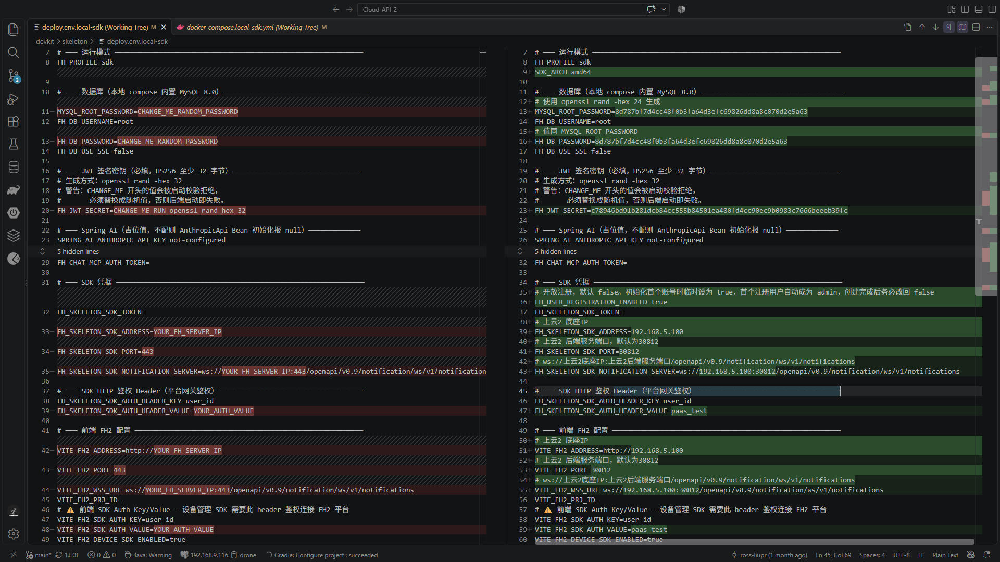
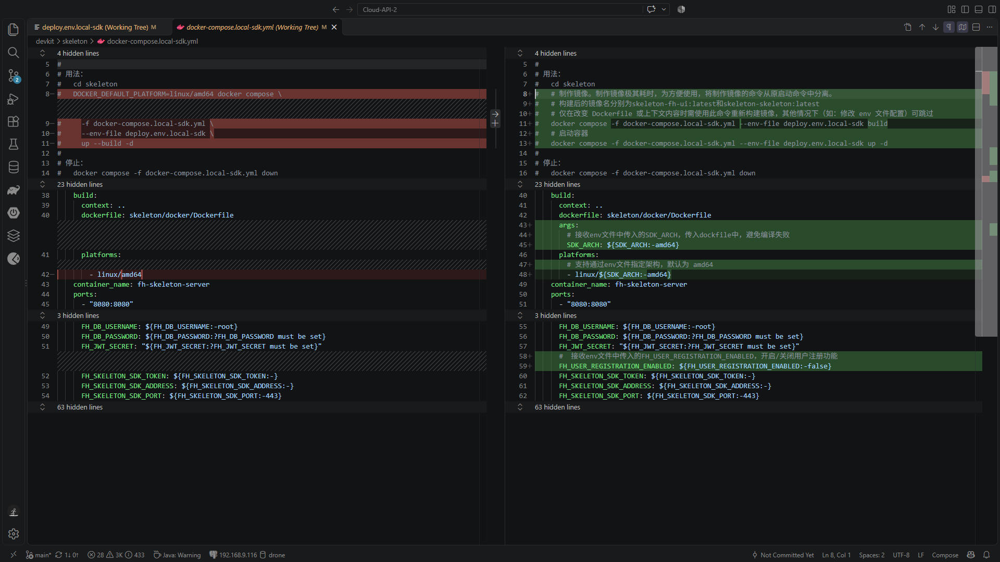
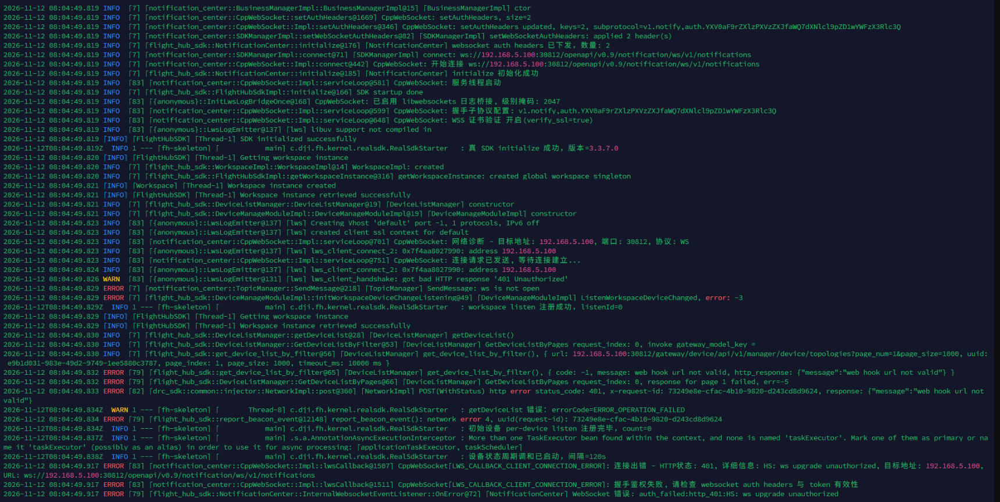

# 上云API2 demo相关问题

## 无法使用docker composes以sdk模式运行skeleton demo

### 问题现象

我暂时还不想写DEMO，只是想运行skeleton demo，熟悉项目，看看sdk用法和效果。

官方仓库<https://github.com/dji-sdk/Cloud-API-2> 最新的 commit记录中（commit id:`fd679f89301295e3c2085a90dac1d5750cfa563d`），`docker-compose.local-sdk.yml`文件提供的下列命令存在一些问题。若不进行改动，无法以SDK模式编译并启动skeleton demo、启动后无法创建管理员账户。

```bash
cd skeleton
DOCKER_DEFAULT_PLATFORM=linux/amd64 docker compose -f docker-compose.local-sdk.yml --env-file deploy.env.local-sdk up --build -d
```

### 问题原因
1. 默认启动命令使用的Dockfile文件位于`skeleton/docker/Dockerfile`，该启动命令未传入`SDK_ARCH`指定架构，导致构建时无法正确选择SDK架构。
2. env文件中，FH_SKELETON_SDK_*等环境变量含义不清晰、填写错误
3. env和yml文件中，未配置FH_USER_REGISTRATION_ENABLED，无法打开用户注册功能

### 解决办法

1. 参考[deploy.env.local-sdk](./resources/deploy.env.local-sdk) 和 [docker-compose.local-sdk.yml](./resources/docker-compose.local-sdk.yml) 文件，修改skeleton目录下的同名文件，主要修改内容如下图：



2. 在skeleton目录下依次执行以下命令：
```bash
# 制作镜像。仅在改变 Dockerfile 或上下文内容时需使用此命令重新构建镜像，其他情况下（如：修改 env 文件配置）可跳过 
docker compose -f docker-compose.local-sdk.yml --env-file deploy.env.local-sdk build
# 启动容器
docker compose -f docker-compose.local-sdk.yml --env-file deploy.env.local-sdk up -d
```

3. 观察容器状态，尤其是`fh-skeleton-server`容器的运行状态，确保其已正常启动。
4. 若反复出现以下报错，需使用[上云API2部署相关问题](上云API2部署相关问题.md)中的【ISV 鉴权地址未生效】相关内容进行修复。
