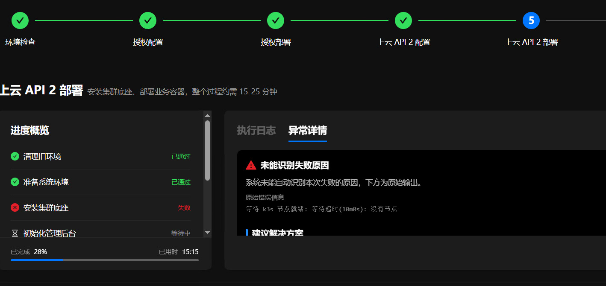
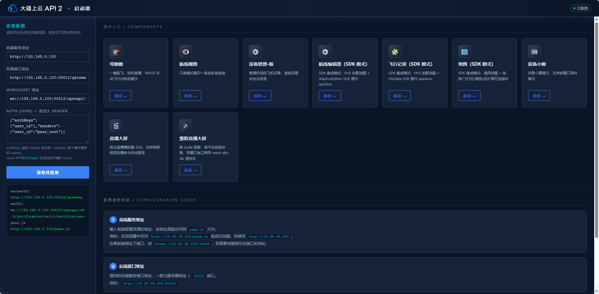
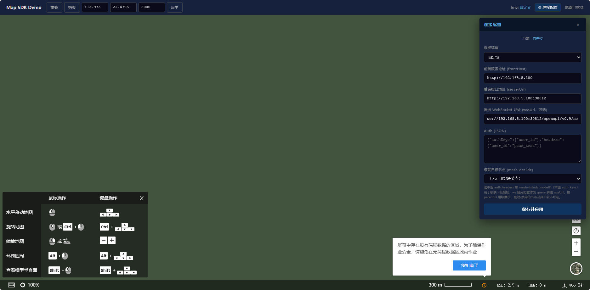
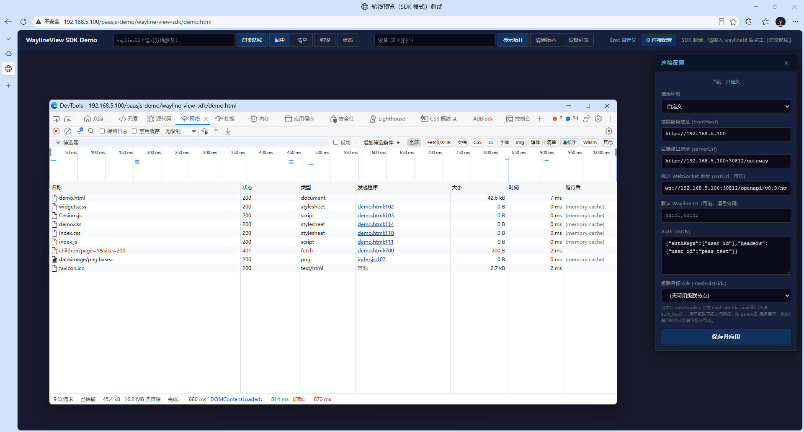
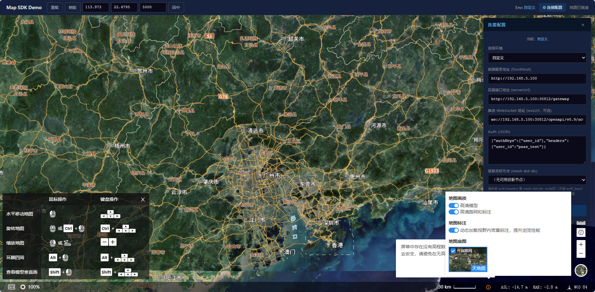
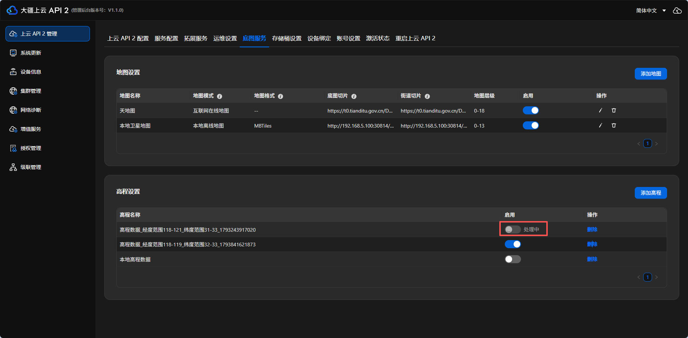
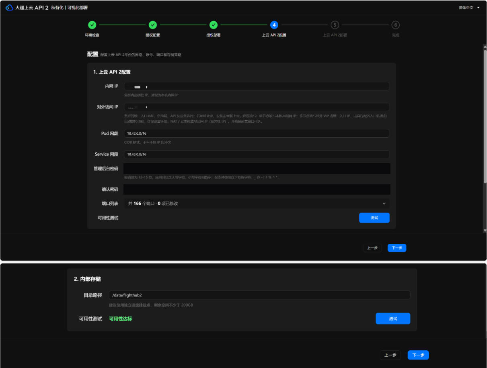

# 上云API2部署相关问题

## 等待k3节点就绪：等待超时（10m0s）：没有节点
### 问题现象
如图，部署时报错


### 问题原因
磁盘性能不足导致，导入节点信息超时，无法完成节点就绪。见[相关讨论](https://github.com/dji-sdk/Cloud-API-2/issues/435)

### 解决方案
等待后台镜像导入完成。在底座服务器的日志中看到 113 / 23 / 8 共三个 "Imported ... in ...s" 完成后，再重试。

注：上云2 v1.1.0使用了k3s，对服务器的CPU和硬盘读写速度要求比较严格：
* 实测6核/8核CPU已无法部署，建议使用16核CPU；
* 内存32GB可以满足部署要求；
* 机械硬盘尚未部署成功过，建议使用高性能固态硬盘。

此外，Terra当前只能和上云2底座部署在同一台服务器上。

## 上云2 v1.1.0底座部署成功后，地图瓦片不显示（ISV 鉴权地址未生效）

### 问题现象
上云API 2 部署成功后，在启动器中按照提示填写了下表中的配置。



| 配置                        | 值                                                                        |
| --------------------------- | ------------------------------------------------------------------------- |
| 前端服务地址                | http://{上云API2底座IP}                                                   |
| 后端接口地址                | http://{上云API2底座IP}:30812/gateway                                     |
| WebSocket 地址              | ws://{上云API2底座IP}:30812/openapi/v0.9/notification/ws/v1/notifications |
| Auth (JSON) — 自定义 Header | {"authKeys":["user_id"],"headers":{"user_id":"paas_test"}}                |

但是进入带地图的demo后，仍出现下列问题：

1. 访问<http://{上云API2底座IP}/paasjs-demo/index.html> 中的demo，地图瓦片不显示：


2. F12打开浏览器网络控制台，无法看到地图瓦片相关的请求，且有请求出现401错误：


出现问题时，已在上云API 2 的 demo 中配置以下内容：

### 问题原因
上云API 2 V1.1.0 集群版存在已知问题（ISV 鉴权地址未生效），需使用官方提供的临时脚本修复<https://pan-sec.djicorp.com/s/cxR7eHxxTBCnXam>

### 解决方案
修复脚本见 [官方提供的临时脚本](https://pan-sec.djicorp.com/s/cxR7eHxxTBCnXam) 或 [fix-isv-webhook.sh](./resources/fix-isv-webhook.sh)。

将该脚本上传到底座服务器的任意目录下，执行：`sudo bash fix-isv-webhook.sh <Webhook地址>` 命令。

例如：`sudo bash fix-isv-webhook.sh  http://<上云API2底座IP>:30812/gateway/test/webhook-auth`

注意事项：
* 该脚本为临时修复，配置不会永久保存。在管理后台修改并保存任何配置、服务器重启、平台升级/更新之后，均需重新执行一次脚本；
* 判断是否需要重跑：页面接口开始大面积报 401 时，执行一次即可；
* 请勿通过修改 env 并执行 cli update 的方式处理，否则会使脚本修复失效，并覆盖管理后台已配置的 HTTPS；
* 大疆后续将提供修复版安装器，届时无需再使用该脚本。


## 上云2 v1.1.0底座部署成功后，无法加载高程
### 问题现象
1. 已在AIO管理页面上传并启用高程数据，但在启动器的DEMO中提示 “屏幕中存在没有高程数据的区域，为了确保作业安全，请避免在无高程数据区域内作业” ，地图上没有红色虚线框。


2. F12 打开浏览器网络控制台，访问 查看 `http://<上云API2底座IP>:30812/gateway/dem/api/v2/terrain-tiles/wgs84/layer.json?ah=ak` 接口响应结果，为
    ```json
    {
        "code": 235404,
        "message": "layer json not exist"
    }
    ```

3. AIO管理页面中，导入高程数据后，状态一直卡在“启用中”

   
### 问题原因
见文档 [在集群版本上云 API 2 管理后台的「高程设置」中，发布的高程数据一直显示「处理中」](https://s.apifox.cn/f70356fe-0b06-4a9d-ad66-372ffb1d4262)

服务器磁盘读写性能不足，导入耗时超过管理服务的等待上限，导入任务失败。

### 解决方案
修复脚本见 [官方提供的临时脚本](https://s.apifox.cn/f70356fe-0b06-4a9d-ad66-372ffb1d4262) 或 [fh2-elevation-fast-import.sh](./resources/fh2-elevation-fast-import.sh)。

可视化部署【上云API配置】步骤中应配置了【内部存储-目录路径】，默认为`/data/flighthub2` 。


将脚本上传到底座服务器的该目录下，并在该目录下执行：
```bash
sudo bash fh2-elevation-fast-import.sh
```

脚本默认重新发布最后上传的高程数据。

若要重新发布指定的高程数据，可先用执行脚本查询已上传的高程数据列表，再传入高程数据的 ID进行发布，例如：
```bash
# 先查看数据集 id
sudo bash fh2-elevation-fast-import.sh --list
# 指定要发布的数据集
sudo bash fh2-elevation-fast-import.sh --id <高程数据ID>
```
